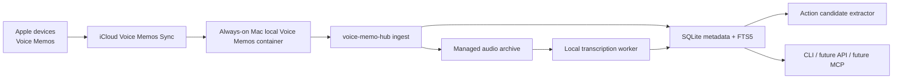

# Voice Memo Hub Project Plan

Version: 0.1.0
Last updated: 2026-06-17

## Intent

Use Apple Voice Memos as a fast capture channel for memories, tasks, ideas,
project notes, and Codex background work requests.

## Architecture

## Success Evidence

- New synced Voice Memo appears in the managed archive.
- SQLite has metadata, file hash, source ID, and status.
- Transcript is searchable through FTS5.
- Action candidates are queued, not automatically executed.
- The service machine can run the loop from launchd.
- Secondary machines can query output without becoming canonical writers.

## Data Model

- `recordings`: canonical memo metadata.
- `transcript_versions`: model/versioned transcript outputs.
- `transcript_segments`: timestamped transcript chunks.
- `action_candidates`: conservative extracted workflow/task candidates.
- `workflow_runs`: future dispatch records.

## Safety

- Local transcription first.
- Cloud transcription opt-in only.
- External writes require approval unless allowlisted.
- Runtime data is excluded from git.

## Build Phases

1. Read-only ingest and query.
2. Optional local transcription worker.
3. Action candidate extraction.
4. launchd install on an always-on Mac.
5. Remote query/API/MCP.
6. Codex delegate dispatch with approval policy.
